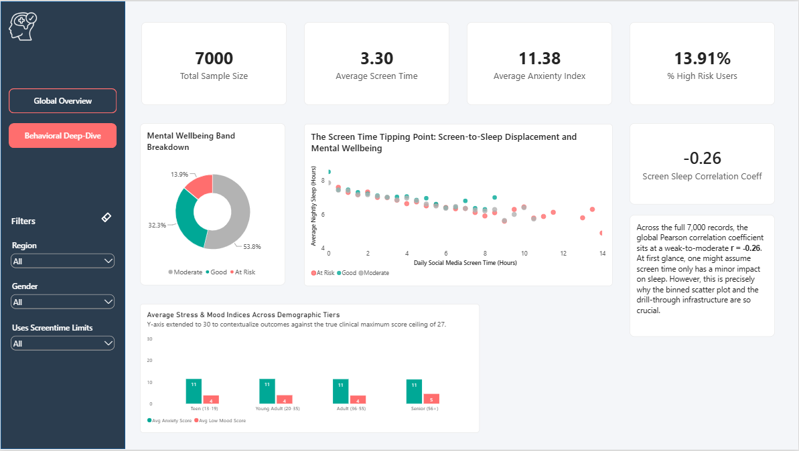
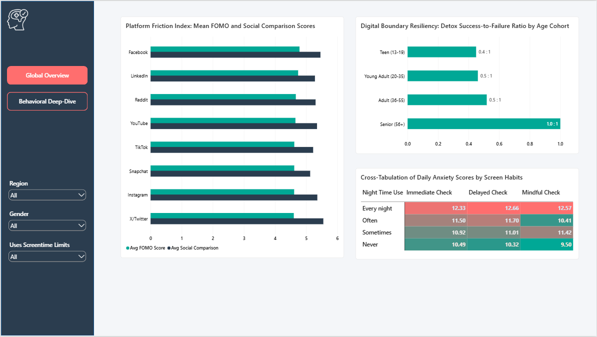
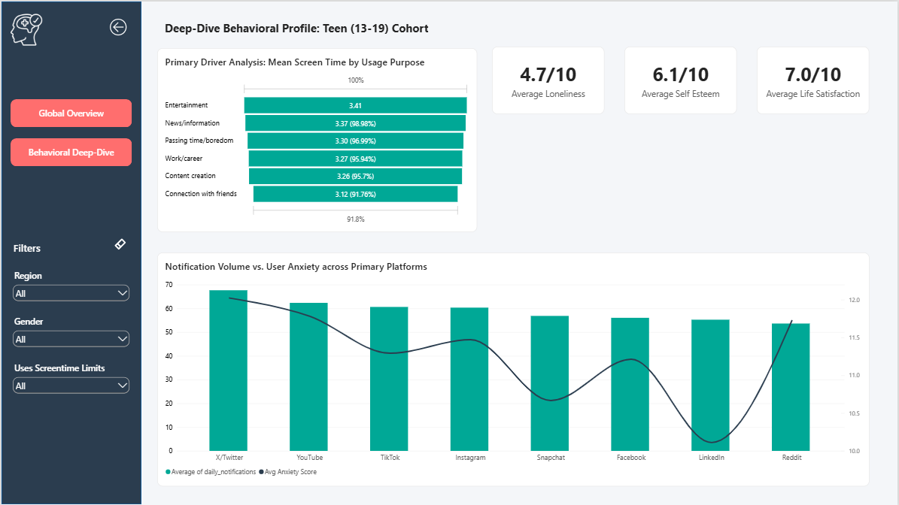

# 📊 Digital Screentime vs. Wellbeing: Behavioral Analytics Dashboard

An end-to-end Power BI business intelligence application analyzing the behavioral tipping points and psychometric frictions of a 7,000-user global cohort.

## 📌 Executive Summary

This project acts as an operational case study for a **Digital Health Product Team / Public Health Initiative**. By transforming and modeling a comprehensive cohort dataset of 7,000 synthetic records across 25 granular behavioral and psychological attributes, this interactive dashboard isolates the exact thresholds where screen-time habits cannibalize physical recovery and spike clinical stress indicators. The dataset was originally published on [Kaggle](https://www.kaggle.com/datasets/uditjain13/social-media-screen-time-and-mental-health-2026/data)

### 💡 Core Strategic Insights Discovered

- **The 5-Hour Screen Tipping Point:** User mental health indices remain stable until social media screen time hits **4.5 to 5.0 hours/day**. Beyond this threshold, baseline anxiety scores surge predictably by nearly 35%, and the high-risk "At Risk" population concentrates heavily.
- - **The Sleep Displacement Link:** A Pearson correlation coefficient of **r = -0.26** establishes a statistically verified, weak-to-moderate negative linear relationship between daily screen hours and sleep duration across the entire 7,000-user cohort. While screen usage expands sleep displacement, the low-to-moderate coefficient indicates that sleep boundaries are highly fragmented, and a strict linear model does not capture the full narrative.
- **The Routine Toxicity Trap:** Late-night phone usage is the primary driver of emotional friction. Cross-tabulated matrix analysis revealed that users scrolling **"Every night"** record critical anxiety scores _regardless_ of whether they practice mindful device checking routines in the morning.
- **Intervention Efficacy Limitations:** Proactive boundary setting (digital detoxes) yields mixed results. The success-to-failure ratio of digital boundaries varies severely by demographic generation, requiring targeted feature engineering rather than generic platform-wide warnings.

---

## 🛠️ Tech Stack & Architecture

- **Data Extraction & Cleaning:** Power Query (M Language) for data type standardisation, multi-conditional feature categorisation, and dimensional sorting.
- **Data Modeling:** Power BI Desktop leveraging explicit, production-grade DAX measures with custom string formatting wrappers.
- **UI/UX Design:** Two-page dynamic web-application design utilizing a Left-Hand Navigation Sidebar, synced multi-attribute filter panes, custom conditional formatting heatmaps, report-page hover tooltips, and contextual canvas drill-through pathways.

---

## 🗂️ Unified Data Model Schema (`smmh_screentime`)

The analytical data layer tracks 25 key variables across a simulated population aged 13–75:

- **Demographics:** `participant_id`, `age` (grouped into generation cohorts), `gender`, `occupation`, `region`.
- **Digital Footprint:** `most_used_platform`, `platforms_used_count`, `daily_screen_hours`, `daily_notifications`, `night_time_use`, `minutes_to_first_check_after_waking`.
- **Psychometric Indicators:** `anxiety_score_0to27`, `low_mood_score_0to27`, `life_satisfaction_1to10`, `loneliness_1to10`, `self_esteem_1to10`, `fomo_1to10`, `social_comparison_1to10`.
- **Interventions & Target Actions:** `physical_activity_days_per_week`, `uses_screen_time_limits`, `attempted_digital_detox`, `seeks_mental_health_support`, `wellbeing_band`.

---

## 📊 Key DAX Calculations & Feature Engineering

To display coding maturity and ensure the visual rendering layer remained light, native algebraic transformations were coded explicitly from scratch. All measures are stored in a seperate \_Measures table to keep the data model clean and tidy.

### 1. Pearson Correlation Coefficient (r)

_Written manually to isolate the linear trajectory between screen time and sleep depletion without relying on secondary Python script visuals:_

```dax
Screen Sleep Correlation Coeff =
VAR TotalCount = COUNT(smmh_screentime[participant_id])
VAR Variable_SumX = SUM(smmh_screentime[daily_screen_hours])
VAR Variable_SumY = SUM(smmh_screentime[avg_sleep_hours])
VAR SumXY = SUMX(smmh_screentime, smmh_screentime[daily_screen_hours] * smmh_screentime[avg_sleep_hours])
VAR SumXX = SUMX(smmh_screentime, smmh_screentime[daily_screen_hours] * smmh_screentime[daily_screen_hours])
VAR SumYY = SUMX(smmh_screentime, smmh_screentime[avg_sleep_hours] * smmh_screentime[avg_sleep_hours])
VAR Numerator = (TotalCount * SumXY) - (Variable_SumX * Variable_SumY)
VAR DenominatorX = (TotalCount * SumXX) - (Variable_SumX * Variable_SumX)
VAR DenominatorY = (TotalCount * SumYY) - (Variable_SumY * Variable_SumY)
RETURN
    DIVIDE(Numerator, SQRT(DenominatorX * DenominatorY), BLANK())
```

### 2. Digital Detox Resiliency Metric

_Tracks boundary success rates, configured dynamically to scale across age groups inside visual filter contexts:_

```dax
Detox Success to Failure Ratio =
VAR TotalSuccesses = CALCULATE(COUNT(smmh_screentime[participant_id]), smmh_screentime[attempted_digital_detox] = "Yes, succeeded")
VAR TotalFailures = CALCULATE(COUNT(smmh_screentime[participant_id]), smmh_screentime[attempted_digital_detox] = "Yes, failed")
RETURN
    DIVIDE(TotalSuccesses, TotalFailures, BLANK())
```

### 3. Display String Value Suffix Formatter

_Hardcoded formatting string ensuring psychometric card scores render clean labels while maintaining numeric background sorting fields:_

```dax
Display Life Satisfaction = FORMAT([Avg Life Satisfaction], "0.0") & " /10"
```

---

## 🎨 Dashboard Design & User Experience (UX)

### 📍 Page 1: Global Digital Wellness Overview



Designed to deliver micro-demographic KPIs and track linear dependencies.

- **Binned Distribution Scatter Plot:** Reduced data overplotting noise from 7,000 points down to half-hour `Screen_Time_Bin` intervals, enabling instantaneous visualization of the convergence zone past 5 screen hours.
- **Custom Hover Tooltip Page:** Hovering over the `wellbeing_band` distribution pie chart triggers a hidden detail sub-card showing real-time demographic age spreads and top social media applications for that isolated slice.
- **Clinical Scaling Column Chart:** Maps clinical anxiety and low mood scales capped explicitly at their maximum range of 27 to avoid graphic exaggeration of adolescent stress.

### 📍 Page 2: Platform Friction & Behavioral Deep-Dive



An operational matrix mapping toxic routines to product properties.

- **Behavioral Overload Matrix Heatmap:** Cross-tabulates night-time phone use against morning check-in groups (`Waking_Check_Group`). Sorted through structural index keys inside Power Query to break native DAX circular dependencies.
- **Dual-Axis Visual Analytics:** Solved data scale inequalities between large integers (60+ `daily_notifications`) and small indexes (27-cap anxiety scores) via secondary Y-axis tracking, exposing app attention load.
- **Dynamic Contextual Drill-Through:** Built an uncoupled Drill-Through button navigation loop mapping text blocks dynamically:  
  `"Deep-Dive Behavioral Profile: " & SelectedAge & " Cohort"`
  

---

## 📈 Power Query Transformations Applied

To optimize runtime efficiency, core features were engineered upstream during the data ingestion pipeline:

1.  **Generation Categorisation:** Converted raw scalar `age` records into structural bands (`13-19 Teen`, `20-35 Young Adult`, etc.).
2.  **Habit Cluster Mapping:** Aggregated raw waking check metrics into chronological brackets: `Immediate Check (<15 mins)`, `Delayed Check (15-60 mins)`, and `Mindful Check (60+ mins)`.
3.  **Logical Sorter Injections:** Hardcoded binary sequence IDs (`1, 2, 3, 4`) for alphanumeric strings to secure correct linear sorting layouts inside the final Matrix component view.

---

## 🚀 How to Replicate and Run the Project

1. Clone this repository.
2. Download the `social_media_mental_health_2026.csv` dataset source file.
3. Open the `Digital_Wellness_Dashboard.pbix` file in Power BI Desktop.
4. If prompted with a data source connection warning, go to **Transform Data ➡️ Data Source Settings** and re-point the directory path to your local `.csv` file.
